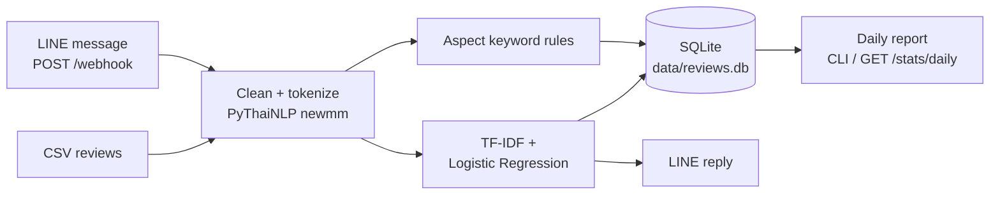

# mlproj — Thai Review Sentiment Pipeline

Thai review sentiment (positive / negative) + aspect tags (taste, price, service, ambience), stored in SQLite with a daily report. Served through FastAPI and a LINE bot webhook.

The model is trained from scratch (PyThaiNLP tokenization → TF-IDF → Logistic Regression). It is **not** an LLM call.

## Flow



## Quick start
```bash
pip install -r requirements-notebooks.txt   # API deps + Hugging Face download (training needs it)
cp .env.example .env              # LINE_ACCESS_TOKEN, LINE_CHANNEL_SECRET (only needed for /webhook)
python -m src.train               # downloads Wongnai/Wisesight from Hugging Face, writes models/*.pkl
uvicorn src.main:app --reload
curl -X POST localhost:8000/analyze -H 'Content-Type: application/json' -d '{"text":"ส่งช้ามาก อาหารเย็นหมด"}'
```

Docker (mount the trained models; they are not baked into the image):
```bash
docker build -t mlproj .
docker run -p 8000:8000 --env-file .env -v "$PWD/models:/app/models" -v "$PWD/data:/app/data" mlproj
```

## Pipeline
```bash
python -m src.pipeline ingest data/reviews.csv   # header: review[,created_at]; headerless: review in col 0
python -m src.pipeline report --days 14
```
- Stored in `data/reviews.db` (override with `DB_PATH`). Duplicates are skipped, so re-running is safe.
- LINE messages received on `/webhook` are stored too (text only, no user id).
- `GET /stats/daily` returns the same report as the CLI.

### Known limitation: dates
The training/demo data ([Wongnai](https://huggingface.co/datasets/Wongnai/wongnai_reviews)) has **no timestamps**. Rows without `created_at` get the ingest time, so undated data lands on a single day and the daily report shows no trend. A real trend needs dated data: a CSV with a `created_at` column, or LINE messages collected over time.

## Results

Sentiment (positive / negative). Labels: Wongnai stars ≥4 → positive, ≤2 → negative, 3 dropped; Wisesight `pos` / `neg`, `neu` and `q` dropped.
Wongnai train: 25,039 reviews after dropping duplicates and train rows that also appear in test. Hyperparameters were chosen on a 10% stratified validation split. The test sets were only used for the final numbers.

| model | Wongnai test macro-F1 (95% CI) | Wongnai F1 negative | Wisesight macro-F1 (cross-domain) | latency p50 | size |
|---|---|---|---|---|---|
| always "positive" | 0.485 | 0.000 | 0.292 | – | – |
| **TF-IDF + LR** | **0.862** (0.839–0.884) | **0.739** | 0.473 | 0.6 ms | 1.2 MB |

Wongnai test = the published test split (4,296 reviews, 6% negative). Wisesight = its test split, pos/neg only (1,161 messages, 59% negative). Latency is per review on CPU and includes text cleaning. Full write-up: [notebooks/02_baseline.ipynb](notebooks/02_baseline.ipynb).

Read this carefully:
- The data is imbalanced (~94% positive in test). "Always positive" already scores 94% accuracy, so **macro-F1 and negative-class F1 are the numbers to look at**, not accuracy.
- The weak spot is recall on negatives: 31% of negative Wongnai reviews are predicted positive. They are mostly mixed reviews that open with praise.
- Wisesight (social media, many topics) shows how badly the model transfers outside restaurant reviews. 80% of Wisesight negatives are predicted positive.
- The earlier README reported macro-F1 0.83 on a random 80/20 split of the training file. That measured something different, so it can't be compared with the numbers above.
- Aspects (taste / price / service / ambience) come from a keyword baseline in `src/aspects.py`. They have **not been measured** yet: a 400-sentence hand-labeled set is being built (see below).

### Aspect labels
`notebooks/05_aspects.ipynb` splits reviews into sentences and compares the keyword baseline with zero-shot embeddings (`BAAI/bge-m3`). It then writes `data/labels/aspect_sentences.csv`: 400 sentences to label by hand with `pos` / `neg` / `neu` per aspect, following [docs/aspect_labeling_guide.md](docs/aspect_labeling_guide.md). Those labels are used to measure both methods and to train an aspect classifier.

### Topics and complaint patterns (unvalidated)
`notebooks/06_topics_mining.ipynb` clusters the same sentences with BERTopic and mines association rules between aspect complaints and low ratings, on a sample of 2,000 reviews (400 per star):
- Service complaints are less common than food complaints (12% vs 25% of reviews), but 86% of reviews with one are rated 1–2 stars (vs 72% for food). The service topic has the lowest average rating of any aspect topic (1.74 stars).
- Topics outside the four aspects (parking, location, opening hours) come from reviews with average ratings, so they don't explain low ratings.
- Praise barely predicts high ratings (lift ≤ 1.23), because almost every review praises something.

The aspect sentiment behind these numbers (keywords × baseline sentence sentiment) has not been validated yet.

## Data source
- [Wongnai reviews](https://huggingface.co/datasets/Wongnai/wongnai_reviews): restaurant reviews from wongnai.com, LGPL-3.0.
- [Wisesight Sentiment](https://huggingface.co/datasets/pythainlp/wisesight_sentiment): Thai social-media messages, CC0.

Both are downloaded from Hugging Face by `src/data/load.py` and are not committed. Check the license terms before showing or redistributing the raw text.

## Test / CI
```bash
pytest
```
GitHub Actions (`.github/workflows/ci.yml`) runs pytest on every push and pull request. Tests do not need trained models.

## Layout
```
src/cleaner.py      Thai text cleaning + tokenization (keeps negation words)
src/train.py        train the served model (same splits/settings as notebook 02) + print metrics
src/predictor.py    model wrapper shared by API and pipeline
src/aspects.py      sentence splitting + token-based aspect keywords (taste / price / service / ambience)
src/db.py           SQLite store + daily report
src/pipeline.py     ingest / report CLI
src/main.py         FastAPI app + LINE webhook
src/data/load.py    load Wongnai / Wisesight from Hugging Face (Parquet) + label mapping
src/data/splits.py  fixed train / val / test splits shared by every model
src/models/baseline.py  TF-IDF + Logistic Regression pipeline (used by train.py and notebooks)
src/models/transformer.py  WangchanBERTa input prep (lowercase, spaces -> <_>, head/head+tail truncation)
src/metrics.py      macro-F1 / per-class F1 + bootstrap confidence interval
src/viz.py          Thai font setup for matplotlib
notebooks/01_eda.ipynb   EDA + the data decisions it led to (pip install -r requirements-notebooks.txt)
notebooks/02_baseline.ipynb  baseline re-evaluated on the published test set + Wisesight -> reports/metrics/baseline.json
notebooks/03_wangchanberta.ipynb  fine-tune WangchanBERTa on Colab (T4), MLflow tracking -> reports/metrics/wangchanberta.json
notebooks/05_aspects.ipynb  aspects: keyword vs zero-shot (bge-m3), builds the labeling set
notebooks/06_topics_mining.ipynb  BERTopic topics + association rules (aspect complaints -> low ratings) -> reports/topics.csv
data/labels/        hand-labeled data (committed; the rest of data/ is not)
docs/aspect_labeling_guide.md  rules for labeling aspects
reports/figures/    figures exported by the notebooks
```
