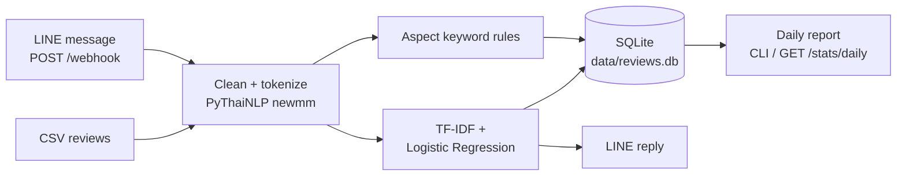

# mlproj — Thai Review Sentiment Pipeline

Thai review sentiment (positive / negative) + aspect tags (food, rider, delay, price), stored in SQLite with a daily report. Served through FastAPI and a LINE bot webhook.

The model is trained from scratch (PyThaiNLP tokenization → TF-IDF → Logistic Regression). It is **not** an LLM call.

## Flow



## Quick start
```bash
pip install -r requirements.txt
cp .env.example .env              # LINE_ACCESS_TOKEN, LINE_CHANNEL_SECRET (only needed for /webhook)
python -m src.train               # needs data/train.csv, writes models/*.pkl
uvicorn src.main:app --reload
curl -X POST localhost:8000/analyze -H 'Content-Type: application/json' -d '{"text":"ส่งช้ามาก อาหารเย็นหมด"}'
```

Docker (mount the trained models; they are not baked into the image):
```bash
docker build -t mlproj .
docker run -p 8000:8000 --env-file .env -v "$PWD/models:/app/models" -v "$PWD/data:/app/data" mlproj
```

## Pipeline
```bash
python -m src.pipeline ingest data/reviews.csv   # header: review[,created_at]; headerless: review in col 0
python -m src.pipeline report --days 14
```
- Stored in `data/reviews.db` (override with `DB_PATH`). Duplicates are skipped, so re-running is safe.
- LINE messages received on `/webhook` are stored too (text only, no user id).
- `GET /stats/daily` returns the same report as the CLI.

### Known limitation: dates
The training/demo data ([Wongnai](https://huggingface.co/datasets/Wongnai/wongnai_reviews)) has **no timestamps**. Rows without `created_at` get the ingest time, so undated data lands on a single day and the daily report shows no trend. A real trend needs dated data: a CSV with a `created_at` column, or LINE messages collected over time.

## Results

Trained on Wongnai restaurant reviews: rating ≥4 → positive, ≤2 → negative, 3 dropped, duplicates removed (27,822 rows; 80/20 stratified split, 5,565 test reviews).

| class | precision | recall | F1 |
|---|---|---|---|
| Negative | 0.66 | 0.74 | 0.70 |
| Positive | 0.98 | 0.97 | 0.97 |
| **Macro F1** | | | **0.83** |
| Accuracy | | | 0.95 |

Read this carefully:
- The data is imbalanced (~92% positive), so a model that always says "positive" already scores ~92% accuracy. **Macro F1 (0.83) and negative-class F1 (0.70) are the honest numbers**, not 95%.
- This is restaurant-review data, **not food-delivery data**. No accuracy claim is made for delivery reviews.
- Aspects (food / rider / delay / price) are a keyword-rule baseline in `src/aspects.py`. They have **not been measured** against labeled data yet.

### Measure on your own labels
```bash
python -m src.make_label_set 200   # -> data/to_label.csv (delivery-related Wongnai reviews, ~119 found)
# fill sentiment (1/0) and food/rider/delay/price (1/0) by hand, save as data/labeled.csv
python -m src.evaluate             # sentiment report + per-aspect F1
```

## Data source
`data/train.csv` = [Wongnai reviews](https://huggingface.co/datasets/Wongnai/wongnai_reviews) (restaurant reviews from wongnai.com, LGPL-3.0). Not committed (`data/` is gitignored). Check the license terms before showing or redistributing the raw text.

## Test / CI
```bash
pytest
```
GitHub Actions (`.github/workflows/ci.yml`) runs pytest on every push and pull request. Tests do not need trained models.

## Layout
```
src/cleaner.py      Thai text cleaning + tokenization (keeps negation words)
src/train.py        train + evaluate
src/predictor.py    model wrapper shared by API and pipeline
src/aspects.py      aspect keyword baseline
src/db.py           SQLite store + daily report
src/pipeline.py     ingest / report CLI
src/main.py         FastAPI app + LINE webhook
src/evaluate.py     evaluation on hand-labeled reviews
src/data/load.py    load Wongnai / Wisesight from Hugging Face (Parquet) + label mapping
src/viz.py          Thai font setup for matplotlib
notebooks/01_eda.ipynb   EDA + the data decisions it led to (pip install -r requirements-notebooks.txt)
reports/figures/    figures exported by the notebooks
```
